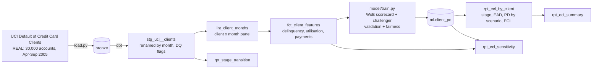

# Credit Risk: PD Scorecard and IFRS 9 Expected Credit Loss

[](https://github.com/Saigwe/credit-risk-ifrs9/actions/workflows/ci.yml)

> A 12-month probability-of-default scorecard and an IFRS 9 loss allowance for 30,000 real credit card accounts: behavioural features built in dbt, a points scorecard validated on a hold-out, a fairness check on characteristics the model never sees, three-stage impairment with the 30- and 90-day backstops, scenario-weighted ECL, a stage transition matrix and assumption sensitivities.

**Author:** Stanley Igwe, Lead Data (Analytics) Engineer · [Portfolio](https://saigwe.github.io)
**Stack:** Python · DuckDB · dbt Core · [dbt-trust-tests](https://github.com/Saigwe/dbt-trust-tests) · scikit-learn · GitHub Actions
**Status:** ✅ Built on the real UCI data. `dbt build` 27/27, pytest 7/7, CI downloads the data and runs everything.

At a Big Four firm I built risk-indicator and transaction datasets for tier-1 banks with audit-ready validation, and finance and credit risk are where I focus now. This repo shows the credit side end to end: from a raw account file to the number that goes into the balance sheet. It uses public data only.

---

## 90-second summary
| | |
|---|---|
| **Problem** | A lender has to set aside a loss allowance under IFRS 9: 12 months of expected loss for performing accounts, lifetime loss for accounts whose risk has risen, and full loss for defaulted ones, all forward-looking and explainable to auditors. |
| **What I built** | dbt models that turn six months of statements into behavioural features; a points scorecard (weight-of-evidence logistic regression) with a gradient-boosting challenger; IFRS 9 staging, exposure at default, scenario-weighted ECL, transitions and sensitivities as dbt models, with every assumption a named, versioned variable. |
| **Why it matters** | Credit and finance get one pipeline from data to allowance, where every account's stage and provision can be traced, and every assumption's effect is visible. |
| **Proof** | Hold-out Gini 0.51 and KS 0.40, calibrated within a few points per decile, score PSI 0.001. Allowance NT$504M on NT$3.29B of exposure, with coverage rising from 7.8% (stage 1) to 46% (stage 2) to 75% (stage 3). The ECL is recomputed independently in Python for every stage in the tests. See [Numbers](#numbers). |

## Architecture


## Data
[UCI "Default of Credit Card Clients"](https://doi.org/10.24432/C55S3H) (Yeh, 2009; CC BY 4.0): 30,000 card accounts in Taiwan with credit limit, six monthly repayment statuses, bills and payments from April to September 2005 (NT$), and whether the account defaulted. 22.1% defaulted, far above a normal card book; the data comes from a period of unusually high card defaults in Taiwan.

Quirks handled in staging, not guessed: the status columns skip `PAY_1` (`PAY_0` is September), education codes 0, 5 and 6 and marital status 0 are undocumented and flagged, and status -1 ("paid in full") defaults more often than 0 ("paid the minimum"), which the scorecard learns rather than assumes.

**The outcome is "default payment next month", the only one in the file.** I treat it as the 12-month default flag for the ECL demonstration and say so wherever the PD is used. A lender would build the PD on a 12-month outcome window.

## Model
- **Features (behavioural only):** limit, current status, worst and count of delinquent months, months paid in full, current and average utilisation and its six-month trend, average and minimum payment ratio. **Sex, marital status, age and education are never inputs** (a test enforces it).
- **Scorecard:** up to 6 quantile bins per feature learnt on the development sample, weight of evidence per bin, logistic regression on WoE, scaled to 600 points at 50:1 odds with 20 points to double the odds. Points per bin are in [`results/scorecard.csv`](results/scorecard.csv), information values in [`results/information_value.csv`](results/information_value.csv).
- **Validation:** stratified 70/30 split (21,000 / 9,000). This is one snapshot, so an out-of-time test isn't possible; with more months I would hold out the latest cohort.

## IFRS 9
| Element | Rule (dbt var) |
|---|---|
| Stage 3 (credit-impaired) | 90+ days past due (3+ months), the rebuttable presumption |
| Stage 2 (significant increase in credit risk) | 30+ days past due (the backstop), or a 12-month PD of 30% or more (`sicr_pd_threshold`). Origination PDs aren't in the data, so an absolute threshold stands in for the relative test |
| EAD | Drawn balance + 50% of the undrawn limit (`ccf`) |
| LGD | 75% for unsecured card balances (`lgd`) |
| Stage 1 ECL | PD × LGD × EAD, discounted one year at the 18% EIR (`eir`) |
| Stage 2 ECL | Lifetime over a 3-year behavioural life (`behavioural_life_years`), constant hazard from the 12-month PD, each year discounted |
| Stage 3 ECL | LGD × EAD |
| Forward-looking | Three scenarios: upside 20% × PD 0.8, base 60% × PD 1.0, downside 20% × PD 1.6 (`scenarios`) |

These are assumptions, not findings, so `rpt_ecl_sensitivity` shows what each one is worth.

## Tests
- **dbt:** keys and accepted values; the client × month panel reconciles to the source bills (`trust_tests.reconciles_to`); the stage summary reconciles to the account level; PDs are probabilities; weighted ECL lies between upside and downside; no ECL exceeds LGD × EAD; stage 3 carries exactly LGD × EAD; coverage rises from stage 1 to 2 to 3.
- **pytest:** the ECL recomputed independently in Python for 50 accounts in each stage; score and PD follow the points scale; scenario weights sum to 1; hold-out Gini, PSI and calibration-in-the-large stay within limits; protected characteristics are not features.

## Numbers
From `make all` on the real file, 26 Oct 2026.

**PD model (9,000-account hold-out)**

| Metric | Scorecard (champion) | Gradient boosting (challenger) |
|---|---:|---:|
| AUC / Gini | 0.756 / 0.512 | 0.775 / 0.551 |
| KS | 0.402 | 0.425 |
| Brier score | 0.140 | 0.136 |
| Mean PD vs observed default rate | 22.0% vs 22.1% | 22.0% vs 22.1% |
| Stability (PSI, development vs hold-out) | 0.001 | 0.001 |

The challenger gains 0.04 Gini. I keep the scorecard as champion because every point is explainable per bin to a customer, an auditor or a regulator; the gap is the price of that, stated here.

Strongest features by information value: current status (0.89), worst delinquency in 6 months (0.76), delinquent months (0.69), minimum payment ratio (0.41). Calibration by decile runs from 7.1% predicted / 6.8% observed in the safest tenth to 70.2% / 69.3% in the riskiest ([`results/calibration_scorecard.csv`](results/calibration_scorecard.csv)).

**Fairness check (hold-out; these characteristics are not model inputs)**

| Group | Observed default rate | Mean predicted PD | Approved at PD < 30% |
|---|---:|---:|---:|
| Female | 21.0% | 21.6% | 81.2% |
| Male | 23.9% | 22.7% | 78.5% |
| Under 30 | 22.5% | 24.0% | 76.4% |
| 30–44 | 20.6% | 20.6% | 82.5% |
| 45+ | 25.7% | 22.6% | 80.1% |

The lowest approval rate is within 7% of the highest for age bands and 3% for sex (ratios 0.93 and 0.97). The finding to act on: the scorecard **under-predicts risk for customers 45 and over** by about 3 points, so their approvals are more generous than their observed defaults justify. A lender would review that segment's calibration before use.

**IFRS 9 loss allowance at 30 September 2005 (NT$)**

| Stage | Accounts | EAD | ECL (weighted) | Coverage | Average 12-month PD |
|---|---:|---:|---:|---:|---:|
| 1 | 22,535 | 2,676.7M | 209.5M | 7.8% | 12.9% |
| 2 | 7,002 | 585.1M | 270.0M | 46.2% | 48.3% |
| 3 | 463 | 32.1M | 24.1M | 75.0% | n/a (defaulted) |
| **Total** | **30,000** | **3,293.8M** | **503.6M** | **15.3%** | |

By scenario: upside NT$413.4M, base NT$483.3M, downside NT$655.0M. Stage 2 holds 18% of exposure and over half the allowance, which is why the SICR rule matters.

**Stage movement, August → September (days-past-due backstops only)**

| From \ to | Stage 1 | Stage 2 | Stage 3 |
|---|---:|---:|---:|
| Stage 1 (25,562) | 22,735 | 2,827 | 0 |
| Stage 2 (3,955) | 392 | 3,291 | 272 |
| Stage 3 (483) | 55 | 237 | 191 |

**What each assumption is worth (base-scenario PDs, total ECL)**

| Case | ECL (NT$) | vs base |
|---|---:|---:|
| Base case | 483.3M | |
| CCF 30% / 70% | 394.4M / 572.1M | −18% / +18% |
| LGD 65% / 85% | 418.9M / 547.7M | −13% / +13% |
| SICR threshold 40% / 20% | 479.3M / 508.7M | −1% / +5% |
| All PDs × 1.6 | 691.7M | +43% |

The drawn-down share of the undrawn limit (CCF) moves the allowance more than LGD does, so it would be the first assumption to evidence.

| Pipeline | Value |
|---|---|
| dbt | 7 models, 20 data tests: 27/27 pass in about 5 s |
| Model training and validation | about 10 s |

## How to run
Requires **Python 3.12** (what CI uses) and `make`, or run the commands in the `Makefile` by hand.
```bash
python -m venv .venv && source .venv/bin/activate   # Windows: .venv\Scripts\activate
pip install -r requirements.txt
make all
```
Change an assumption without editing SQL: `cd dbt && dbt build --select tag:ecl --vars '{lgd: 0.8}'`.

## Roadmap
- [x] Feature pipeline in dbt; scorecard and challenger with validation; fairness check
- [x] IFRS 9 staging, scenario-weighted ECL, transitions, sensitivities, independent recalculation tests
- [ ] Recalibrate the 45+ segment and re-run the fairness check
- [ ] An out-of-time test on a dataset with more history (Freddie Mac loan-level data needs a free registration)
- [ ] Databricks version with MLflow model registry
- [ ] 3-minute Loom walkthrough ([script ready](docs/walkthrough.md))

## Data and licence
- **Data:** Yeh, I.-C. (2009). *Default of Credit Card Clients* [Dataset]. UCI Machine Learning Repository. https://doi.org/10.24432/C55S3H. CC BY 4.0.
- **IFRS 9 parameters** are illustrative assumptions, not any lender's.
- **Code:** MIT (see `LICENSE`).
